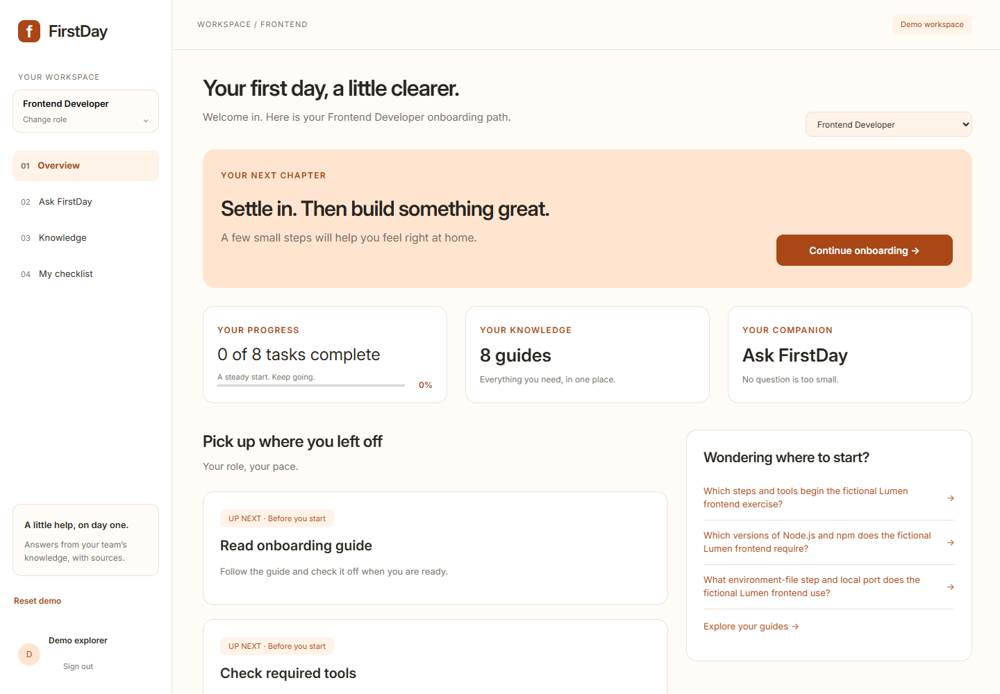
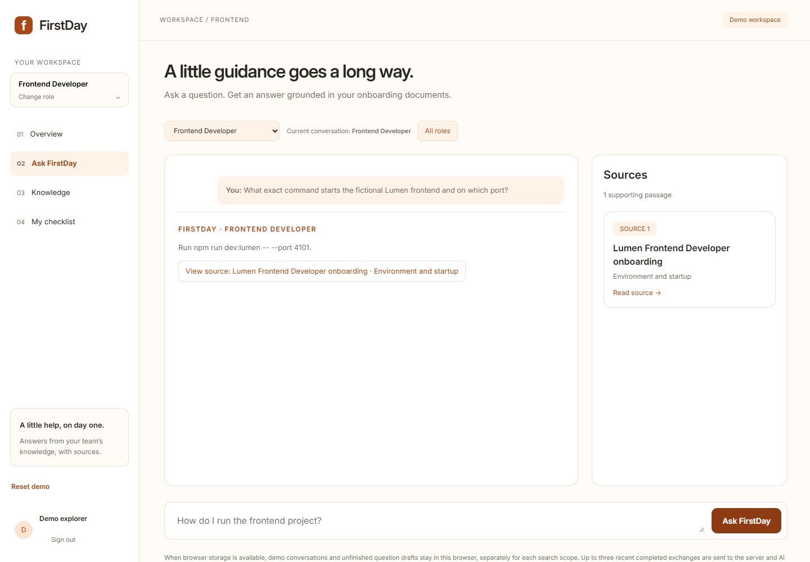
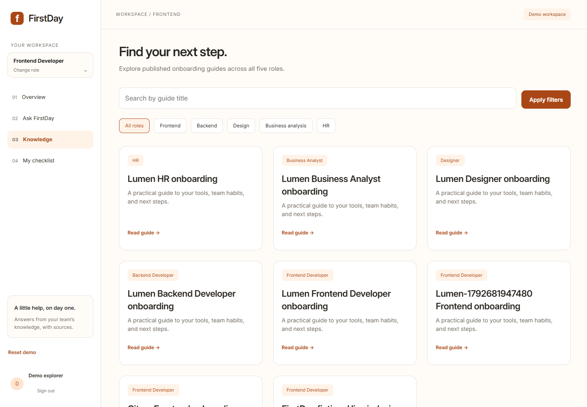
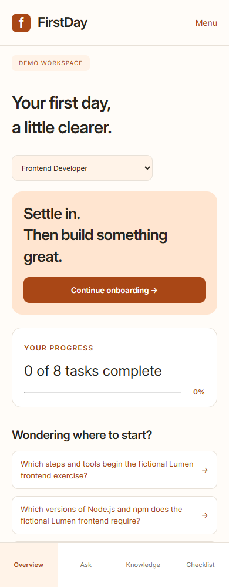
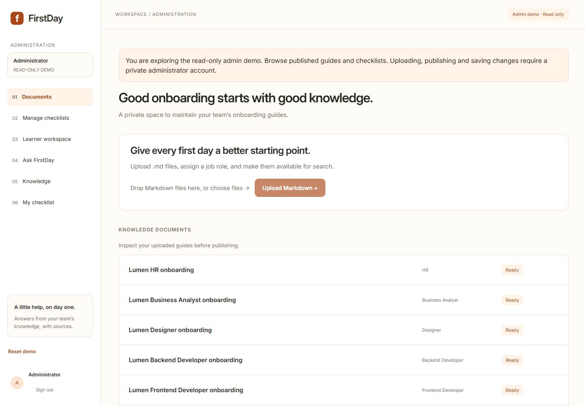

# FirstDay

A clearer first day for every role. FirstDay brings onboarding guides, practical checklists and answers with sources into one workspace.

**[Try the live demo →](https://qw-firstday.vercel.app)**

The demo uses a fictional company, Lumen, so you can explore without signing up.

Choose a role, see your progress and pick up your next onboarding task. Your progress belongs to this browser, so other demo visitors start with their own activity.

## Try it in a few minutes

1. Open the demo and select **View demo account**.
2. Choose **Learner demo**, select **Fill login form**, then **Log in**.
3. Pick a role on Overview (or **Change role** in the desktop sidebar / mobile **Menu**) and open its eight-task onboarding checklist.
4. Select **Open guide** to read the instructions, or **Ask about this task** to prepare a question. Review it and submit when ready.
5. Open an answer's supporting passage to see the guide and exact version behind it.

Try asking how to start the frontend locally, then ask about something the guide does not cover. FirstDay should explain when it cannot find supporting evidence.

## Two ways to explore

| Demo             | What you can try                                                                                                 |
| ---------------- | ---------------------------------------------------------------------------------------------------------------- |
| **Learner demo** | Switch roles, browse guides, ask questions, inspect sources and track your own onboarding progress.              |
| **Admin demo**   | Tour published document inspection and checklist management in read-only mode. Shared content cannot be changed. |

Both accounts are available in the login popup. Full editing belongs to a separate private administrator account.

## Five roles, one starting point

- Frontend Developer
- Backend Developer
- Designer
- Business Analyst
- HR

Each role has a fictional onboarding guide and eight tasks grouped into **Before you start**, **Day 1** and **Week 1**. All visitors can read every role's published guides.

## See FirstDay in action

### Answers with sources

Ask a question in a role’s chat scope and inspect the evidence behind the answer. The source panel links to the supporting passage and its exact document version. This example answers a question about the fictional Lumen frontend exercise; its command is not a FirstDay setup instruction.

### Find the right guide

Use role chips on desktop or the role dropdown on mobile, then search guide titles. Every visitor can browse all five roles’ published onboarding knowledge.

### Take your next step on mobile

The mobile layout keeps progress and suggested questions within reach. Bottom navigation opens Overview, Ask, Knowledge and Checklist; Menu contains role switching and account actions.

Preview the read-only admin tour

Explore published documents and checklist management through **Admin demo** in the login popup. The banner identifies this read-only account; uploading, indexing and saving require a private administrator account.

Screenshots show the live fictional demo on October 24, 2026. Published content, counts and generated wording can change. [Screenshot details](docs/screenshots/README.md).

## What FirstDay demonstrates

- **A practical onboarding path:** see your progress, revisit completed tasks and pick up your next step.
- **Knowledge you can find:** filter published guides by role and search their titles.
- **Answers you can inspect:** questions retrieve relevant guide passages, and supported answers link back to their sources.
- **Room to ask follow-ups:** chat scopes and unfinished questions are kept separately for each role and All roles.
- **A responsive workspace:** use the desktop sidebar or mobile bottom navigation, open source details alongside chat or in a mobile panel, and explore with keyboard-accessible controls.

This is a retrieval-augmented generation (RAG) app: it finds relevant passages before asking an AI model to answer. The guides provide the evidence; the model turns that evidence into an answer.

## Your demo activity

Progress, saved conversations and question drafts stay in this browser. Other visitors using the same demo account do not see your saved activity. Another device or clearing browser data starts fresh.

Questions and relevant guide passages are sent to AI providers to generate answers. The demo contains fictional sample material; it is not a real employee onboarding system.

**Reset demo** clears this browser's progress, conversations and drafts after confirmation. It keeps you signed in and leaves shared guides unchanged.

The demo runs on free services with shared question limits. It may pause or ask you to retry when capacity is unavailable; retry guidance appears in the app.

## Built with

| Part                                 | Technology                        |
| ------------------------------------ | --------------------------------- |
| Application                          | TypeScript, Next.js and React     |
| Authentication and knowledge storage | Supabase, PostgreSQL and pgvector |
| Embeddings                           | Google Gemini                     |
| Answers                              | Groq                              |
| Hosting                              | Vercel                            |
| Design                               | FigCraft                          |

## Explore the project

- [Technical setup and operations](docs/technical-guide.md)
- [Product roadmap](docs/roadmap.md)
- [Native FigCraft design](design/FirstDay.figcraft)
- [Product vocabulary](GLOSSARY.md)
- [Release verification](docs/hosted-verification.md)
